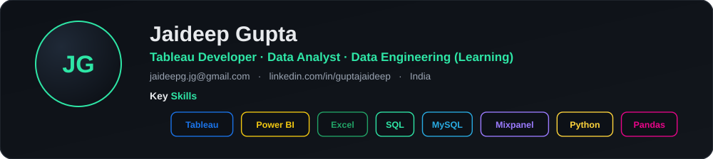
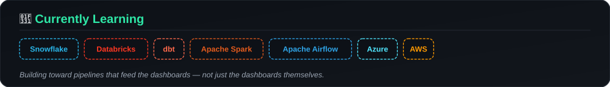

<div align="center">



<a href="https://git.io/typing-svg">
  
</a>

<br>

[](mailto:jaideepg.jg@gmail.com)
[](https://linkedin.com/in/guptajaideep)
[](https://public.tableau.com/app/profile/jaideep.gupta7070/vizzes)
[](https://codebasics.io/portfolio/Jaideep-Gupta)
[](https://www.youtube.com/channel/UCMU9RMjwpglKIhV7HZ0m_5w)

<sub>📍 India &nbsp;·&nbsp; M.Sc. Economics, IIT Roorkee &nbsp;·&nbsp; B.Sc. Statistics & Mathematics, CSJMU</sub>

<br>

<p>
<a href="#about"></a>
<a href="#stack"></a>
<a href="#highlights"></a>
<a href="#projects"></a>
<a href="#experience"></a>
<a href="#learning"></a>
<a href="#connect"></a>
</p>

</div>

<br>

## 🧭 About <a id="about"></a>

I'm a Tableau Developer with 4+ years building BI solutions across **Healthcare, Real Estate, EdTech, and Enterprise** domains. I don't just build dashboards — I design the data foundations underneath them, so the numbers hold up when someone questions them in a meeting. I've built and maintained **50+ dashboards** used by **40+ stakeholders** for operational and strategic decisions.

I'm now expanding from BI into **Data Engineering** — learning Snowflake, dbt, Spark, and Airflow to build the pipelines that feed the dashboards, not just the dashboards themselves. Good data solutions start with the right question, not the right tool; my goal is to bridge BI and Data Engineering into platforms people can actually rely on.

<br>

## 🧰 Stack <a id="stack"></a>

<div align="center">

**BI & Visualization**
<br>


**Data Engineering & Cloud**
<br>


**Programming & Databases**
<br>


**Analytics & Ecosystem**
<br>


</div>

<br>

## 📈 Highlights <a id="highlights"></a>

<div align="center">

| 🕒 | 📊 | 🧑‍🤝‍🧑 | ⚡ |
|:---:|:---:|:---:|:---:|
| **4+ yrs** in BI & Analytics | **50+** dashboards shipped | **40+** stakeholders served | **25%** faster reporting |

</div>

<table>
<tr>
<td width="50%" valign="top">

**🏥 Hospital CRM analytics suite**
Built lead conversion, patient funnel, booking revenue, and inventory analytics — surfaced the exact stage causing a **7% patient conversion drop-off** and helped fix the bottleneck.

</td>
<td width="50%" valign="top">

**☁️ Tableau Next on Salesforce Data Cloud**
Delivered demo solutions across healthcare and real estate showcasing agentic analytics and AI-driven insights, contributing to **4 new client pitches**.

</td>
</tr>
<tr>
<td width="50%" valign="top">

**⚡ Report generation: 8 min → 3 min**
Rebuilt reporting logic using calculated fields, parameters, and dynamic filters — a **60%+ cut** in average generation time.

</td>
<td width="50%" valign="top">

**🧩 25% faster reporting turnaround**
Standardized a shared KPI framework across 3 departments and built reusable SQL templates.

</td>
</tr>
<tr>
<td colspan="2" valign="top">

**📊 Mixpanel funnel analysis**
Identified a **22% onboarding drop-off**; recommended UX changes that lifted feature adoption by **15%** and overall engagement by **17%**.

</td>
</tr>
</table>

<br>

## 🚀 Featured Projects <a id="projects"></a>

<table>
<tr>
<td width="50%" valign="top">

### 🏨 AtliQ Hotels — Hospitality EDA
`Python` `Pandas` `NumPy` `Matplotlib` `Seaborn`

Exploratory analysis of hotel booking, occupancy, revenue, and cancellation patterns across four Indian cities — city/room-class performance, weekday vs. weekend demand, booking-channel contribution, and revenue leakage.

**[→ GitHub Repo](https://github.com/Jaideepgupta/hospitality-eda-atliq-hotels)**

</td>
<td width="50%" valign="top">

### 💊 Pharmacy Sales Dashboard
`Tableau` `Excel`

Interactive dashboard for pharma sales managers across 8 analytical views — field rep performance, doctor engagement, effort-vs-output efficiency, target achievement, and call-outcome quality.

**[→ Live Dashboard](https://public.tableau.com/app/profile/jaideep.gupta7070/viz/PharmacyDashboard_5_17696851082490/PharmacyPerformance)** &nbsp;·&nbsp; **[→ Repo](https://github.com/Jaideepgupta/Pharmacy-sales-dashboard)**

</td>
</tr>
<tr>
<td width="50%" valign="top">

### 📊 Business Insights 360
`Power BI` `SQL` `DAX` `Excel`

Multi-view dashboard (Finance, Sales, Marketing, Supply Chain, Executive) for a consumer electronics company operating across 27+ markets. Star-schema model over 1M+ transaction records, tracking net sales, gross margin %, and forecast accuracy.

**[→ Live Dashboard](https://app.powerbi.com/view?r=eyJrIjoiMzBiNWE5NTgtYWRkYi00MmZlLWE3NmQtMzIzYmJmNzQzMWFkIiwidCI6ImM2ZTU0OWIzLTVmNDUtNDAzMi1hYWU5LWQ0MjQ0ZGM1YjJjNCJ9)** &nbsp;·&nbsp; **[→ Repo](https://github.com/Jaideepgupta/Business_Insights_360)**

</td>
<td width="50%" valign="top">

### 📈 Sales & Finance Analytics
`Excel` `Power Query` `Pivot Tables`

P&L statements by fiscal year, month, and market across 15+ markets and 200+ customers, built for finance teams to benchmark performance and spot high-growth regions.

**[→ GitHub Repo](https://github.com/Jaideepgupta/Excel-Sales-Analytics)**

</td>
</tr>
</table>

<br>

## 💼 Experience <a id="experience"></a>

```
2025 ── Present    Tableau Developer · Kloudrac Group
2024 ── 2025       Freelance Data Analyst
2024 ── 2024       Associate Solution Leader · Brane Enterprises
2022 ── 2023       Product Analyst → SME · TutorBin
```

<details open>
<summary><b>Tableau Developer</b> · Kloudrac Group &nbsp; <code>Aug 2025 – Present</code></summary>
<br>

- Developed 20+ Tableau dashboards across healthcare and real estate, used by 35+ business users
- Built hospital CRM analytics (lead conversion, patient funnel, booking revenue, inventory) — identified a 7% patient conversion drop-off
- Cut report generation time from 8 min to 3 min via calculated fields, parameters, and dynamic filters
- Delivered Tableau Next on Salesforce Data Cloud demos, contributing to 4 new client pitches

</details>

<details>
<summary><b>Freelance Data Analyst</b> &nbsp; <code>Sep 2024 – Aug 2025</code></summary>
<br>

- Delivered 9 analytics projects across 4 industries using Tableau and Power BI
- Trained 20+ professionals in SQL, Tableau, Power BI, and analytics workflows

</details>

<details>
<summary><b>Associate Solution Leader</b> · Brane Enterprises &nbsp; <code>Jan 2024 – Sep 2024</code></summary>
<br>

- Reduced reporting turnaround time by 25% through reusable SQL templates and a shared KPI framework across 3 departments
- Led BI projects for 2 enterprise clients end-to-end

</details>

<details>
<summary><b>Product Analyst → Subject Matter Expert</b> · TutorBin &nbsp; <code>Jun 2022 – Dec 2023</code></summary>
<br>

- Identified a 22% onboarding drop-off via Mixpanel funnel analysis; improved feature adoption by 15% and engagement by 17%
- Built dashboards tracking DAU (12K+), 30-day retention, and conversion rates
- Mentored 100+ students in analytics, SQL, and BI tools (92% satisfaction rating)

</details>

<br>

## 🌱 Currently Learning <a id="learning"></a>



<div align="center">


</div>

<br>

## 🎓 Education & Certifications

<table>
<tr>
<td valign="top" width="50%">

**Education**
- M.Sc. Economics — IIT Roorkee `2017–2019`
- B.Sc. Statistics & Mathematics — CSJMU `2014–2017`

</td>
<td valign="top" width="50%">

**Certifications** (Codebasics)
- SQL (Beginner to Advanced)
- Power BI Data Analytics
- Excel: Mother of Business Intelligence

</td>
</tr>
</table>

<br>

## 📩 Connect <a id="connect"></a>

<div align="center">

Open to connecting — always happy to talk Tableau, data modeling, or the BI-to-data-engineering transition.

[](https://linkedin.com/in/guptajaideep)
[](https://public.tableau.com/app/profile/jaideep.gupta7070/vizzes)
[](https://www.youtube.com/channel/UCMU9RMjwpglKIhV7HZ0m_5w)
[](mailto:jaideepg.jg@gmail.com)

<br><br>


</div>
