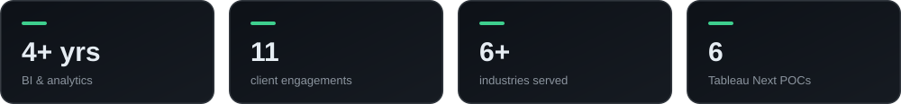

<div align="center">



<a href="https://git.io/typing-svg">
  
</a>

<br>

[](mailto:jaideepg.jg@gmail.com)
[](https://linkedin.com/in/guptajaideep)
[](https://public.tableau.com/app/profile/jaideep.gupta7070/vizzes)
[](https://codebasics.io/portfolio/Jaideep-Gupta)
[](https://www.youtube.com/channel/UCMU9RMjwpglKIhV7HZ0m_5w)

<sub>📍 India &nbsp;·&nbsp; M.Sc. Economics, IIT Roorkee &nbsp;·&nbsp; B.Sc. Statistics & Mathematics, CSJMU</sub>

<br>

<a href="#about"></a> <a href="#projects"></a> <a href="#stack"></a> <a href="#experience"></a> <a href="#focus"></a>

</div>

<br>

## 🧭 About <a id="about"></a>

I'm a Tableau Developer with 4+ years building BI for **Healthcare, Real Estate, EdTech, and Enterprise** teams: **50+ dashboards** used by **40+ stakeholders**. Working on the reporting layer showed me that most problems in a dashboard start upstream, in ingestion, modeling, and data quality. So I've moved into engineering that upstream layer myself.

My recent work is end to end: metadata-driven ingestion with ADF, medallion transforms on Databricks, a dbt Gold layer with tests in CI, Kafka + Structured Streaming with Airflow, and the Power BI / Tableau layer on top. I'm aiming for Analytics Engineering and Data Engineering roles where I can own the path from raw data to a number the business trusts.



<br>

## 🚀 Featured Projects <a id="projects"></a>

### 🛠️ Data Engineering

<table>
<tr>
<td valign="top">

#### 🛒 AtliQ Commerce: End-to-End Data Platform (Batch + Real-Time)

<a href="https://github.com/Jaideepgupta/AtliQ-Commerce-End-to-End-Capstone"></a>


- **Batch:** a control-table-driven ADF pipeline lands OLTP data in Bronze. Databricks does incremental `MERGE` into Silver, and a dbt Gold star schema is served to Power BI / Fabric.
- **Streaming:** a Kafka producer feeds Structured Streaming Bronze → Silver → Gold, with watermarking, deduplication, and separate checkpoints. An Airflow DAG runs the operations.
- **Reliability:** dbt tests gate CI. Revenue, cost, and profit reconcile back to source, and re-running the full pipeline and diffing the results shows it is idempotent.

  

<a href="https://github.com/Jaideepgupta/AtliQ-Commerce-End-to-End-Capstone"></a>

</td>
</tr>
</table>

### 🤖 ML, NLP & Applied Engineering

<table>
<tr>
<td width="50%" valign="top">

#### 📉 Customer Churn Intelligence


Predicts which of 10,000 SaaS accounts will churn, using product telemetry plus sentiment features from support tickets. In the data, negative sentiment shows up **2–3 weeks before** usage drops.

  

<a href="https://jaideepgupta-customer-churn-intelligence---predictiv-app-qaupr1.streamlit.app/"></a> <a href="https://github.com/Jaideepgupta/Customer-Churn-Intelligence---Predictive-Analytics---NLP"></a>

</td>
<td width="50%" valign="top">

#### 🎬 VideoScribe


Turns a video link or upload into clean, searchable text. FastAPI hands jobs to Celery workers (yt-dlp + ffmpeg + speech-to-text), which write output to S3-compatible storage. Includes timestamp navigation, keyword search, and multi-format export.


<a href="https://github.com/Jaideepgupta/Videoscribe"></a>

</td>
</tr>
</table>

### 📊 BI & Analytics

<table>
<tr>
<td width="50%" valign="top">

#### 💊 Pharmacy Sales Dashboard


<a href="https://jaideepgupta.github.io/Jaideepgupta/pharmacy-dashboard.html"></a>

8 analytical views for pharma sales managers: rep performance, doctor engagement, effort vs. output, target achievement, and call-outcome quality.

<a href="https://jaideepgupta.github.io/Jaideepgupta/pharmacy-dashboard.html"></a> <a href="https://github.com/Jaideepgupta/Pharmacy-sales-dashboard"></a>

</td>
<td width="50%" valign="top">

#### 📊 Business Insights 360


Finance, Sales, Marketing, Supply Chain, and Executive views for a consumer-electronics company across 27+ markets. Star schema over 1M+ transactions, tracking net sales, gross margin %, and forecast accuracy.

 

<a href="https://app.powerbi.com/view?r=eyJrIjoiMzBiNWE5NTgtYWRkYi00MmZlLWE3NmQtMzIzYmJmNzQzMWFkIiwidCI6ImM2ZTU0OWIzLTVmNDUtNDAzMi1hYWU5LWQ0MjQ0ZGM1YjJjNCJ9"></a> <a href="https://github.com/Jaideepgupta/Business_Insights_360"></a>

</td>
</tr>
</table>

<details>
<summary><b>More projects</b></summary>
<br>

- **[BRSR / ESG Data Story](https://jaideepgupta.github.io/brsr-esg-data-story/)**: an interactive walkthrough of ESG capability data for 99 companies, covering Spearman correlation with Holm correction, Poisson regression (IRR), robust SEs, and ANOVA.
- **[E-commerce Lakehouse ML Pipeline](https://github.com/Jaideepgupta/ecommerce-lakehouse-ml-pipeline)**: Databricks Bronze/Silver/Gold feature pipeline feeding purchase-prediction and recommendation models.
- **[AtliQ Hotels — Hospitality EDA](https://github.com/Jaideepgupta/hospitality-eda-atliq-hotels)**: Pandas analysis of occupancy, revenue, cancellations, and channel mix across four cities.
- **[Sales & Finance Analytics](https://github.com/Jaideepgupta/Excel-Sales-Analytics)**: Excel / Power Query P&L across 15+ markets and 200+ customers.
- **Reference notes:** [dbt cheatsheet](https://github.com/Jaideepgupta/dbt-cheatsheet) · [Tableau cheatsheet](https://github.com/Jaideepgupta/tableau-cheatsheet) · [SQL prep](https://github.com/Jaideepgupta/sql-prep)

</details>

<br>

## 🧰 Stack <a id="stack"></a>

<div align="center">

**Data Engineering & Cloud**
<br>


**BI & Visualization**
<br>


**Languages, Databases & Tooling**
<br>


</div>

<br>

## 💼 Experience <a id="experience"></a>

```
Aug 2025 ── Present     Tableau Developer · Kloudrac Group
Sep 2024 ── Aug 2025    Freelance Data Analyst
Jan 2024 ── Sep 2024    Associate Solution Leader · Brane Enterprises
Jun 2022 ── Dec 2023    Product Analyst → SME · TutorBin
```

<details open>
<summary><b>Tableau Developer</b> · Kloudrac Group &nbsp; <code>Aug 2025 – Present</code></summary>
<br>

- Developed 20+ Tableau dashboards across healthcare and real estate, used by 35+ business users
- Built hospital CRM analytics (lead conversion, patient funnel, booking revenue, inventory) and pinpointed the funnel stage behind a **7% patient-conversion drop-off**
- Cut report generation time from **8 min to 3 min** by reworking calculated fields, parameters, and dynamic filters
- Delivered Tableau Next on Salesforce Data Cloud demos (agentic analytics, AI-driven insights), which contributed to **4 new client pitches**

</details>

<details>
<summary><b>Freelance Data Analyst</b> &nbsp; <code>Sep 2024 – Aug 2025</code></summary>
<br>

- Delivered 9 analytics projects across 4 industries using Tableau and Power BI
- Trained 20+ professionals in SQL, Tableau, Power BI, and analytics workflows

</details>

<details>
<summary><b>Associate Solution Leader</b> · Brane Enterprises &nbsp; <code>Jan 2024 – Sep 2024</code></summary>
<br>

- Cut reporting turnaround by **25%** with reusable SQL templates and a shared KPI framework across 3 departments
- Led BI projects for 2 enterprise clients end-to-end

</details>

<details>
<summary><b>Product Analyst → Subject Matter Expert</b> · TutorBin &nbsp; <code>Jun 2022 – Dec 2023</code></summary>
<br>

- Found a **22% onboarding drop-off** through Mixpanel funnel analysis. The UX changes that followed lifted feature adoption by 15% and engagement by 17%
- Built dashboards tracking DAU (12K+), 30-day retention, and conversion
- Mentored 100+ students in analytics, SQL, and BI tools (92% satisfaction)

</details>

<br>

## 🌱 Current Focus <a id="focus"></a>

- **Analytics engineering in depth:** dbt incremental models, snapshots (SCD2), contracts, and data-quality testing on Snowflake and Databricks
- **Orchestration & CDC:** production-style Airflow DAGs, change data capture, and backfill/idempotency patterns
- **AI engineering:** LLM applications, MCP servers, and agentic workflows over governed warehouse data
- **AWS:** S3, Glue, and IAM fundamentals for cloud data platforms

<br>

## 🎓 Education & Certifications

<table>
<tr>
<td valign="top" width="50%">

**Education**
- M.Sc. Economics — IIT Roorkee `2017–2019`
- B.Sc. Statistics & Mathematics — CSJMU `2014–2017`

</td>
<td valign="top" width="50%">

**Certifications** (Codebasics)
- SQL (Beginner to Advanced)
- Power BI Data Analytics
- Excel: Mother of Business Intelligence

</td>
</tr>
</table>

<br>

<div align="center">

**Open to Analytics Engineering and Data Engineering roles.** Always happy to talk about Tableau, data modeling, or moving from BI into engineering.
<br>
[LinkedIn](https://linkedin.com/in/guptajaideep) · [Email](mailto:jaideepg.jg@gmail.com)

<br><br>


</div>
